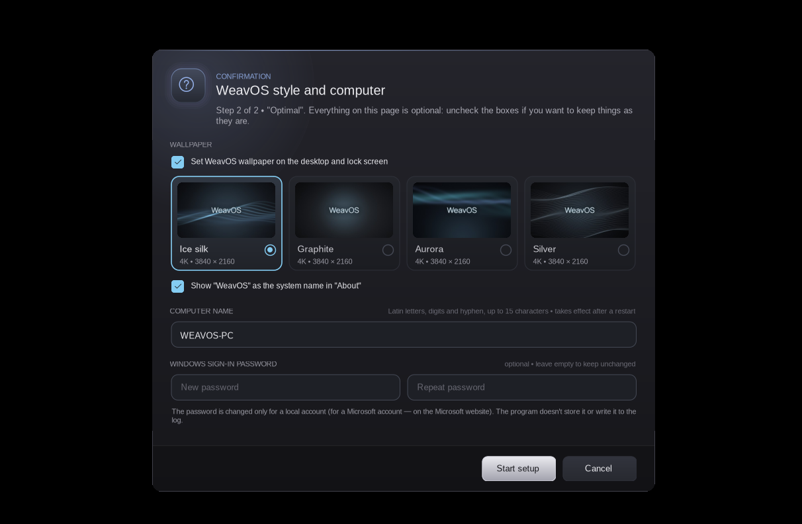

<div align="center">


# WinWeaver

**Windows 11 tuning in a couple of clicks — privacy, appearance, speed and maintenance.**
No PowerShell windows or batch files. Every change can be undone.

[](https://github.com/fel7xxx/WinWeaver/releases/latest)
[](https://github.com/fel7xxx/WinWeaver/actions/workflows/build.yml)
[](LICENSE)

[Русский](README.md) · **English**


</div>

## Download

1. Open the [latest release](https://github.com/fel7xxx/WinWeaver/releases/latest) and download **WinWeaver.exe**.
2. Run it. Windows will ask for administrator rights — they're needed to change system settings.
3. On first launch pick the language and how to run it: **install** to Program Files (Start menu shortcut, removal via "Installed apps") or **run without installing**.

> **SmartScreen.** The program isn't signed with a paid certificate, so Windows may show "Windows protected your PC". Click **More info → Run anyway**. You can verify the file with the SHA-256 from the release (`WinWeaver.exe.sha256`).

**Requirements:** Windows 11 (22H2 – 26H2), administrator rights. .NET Framework 4.8 is already part of Windows 11.

## Features

| | |
|---|---|
| **Auto-tune** | Three levels — Basic, Optimal, Maximum. Every step is shown before it runs and can be turned off. A restore point is created first. |
| **Privacy** | Telemetry, Copilot and Recall, ads and recommendations, Bing in search, location, Defender, BitLocker, Windows Update pause and mode. |
| **Appearance** | Dark theme, classic context menu, taskbar, Start, File Explorer. |
| **Performance** | Power plan, system responsiveness, gaming settings, HAGS, timer, priorities. |
| **Programs** | Uninstall programs together with leftovers, built-in Windows apps, startup. |
| **Network** | Ping, DNS choice (including encrypted DNS), network settings and tools. |
| **Fixes** | Common Windows problems fixed with one button: internet, Start, icons, sound, printer, Windows Update… |
| **Maintenance** | Disk cleanup, Storage Sense, system file check. |
| **Recovery** | Restore points: create, roll back, delete old ones. |
| **History** | Everything the program did. Any change can be undone on its own or as a group. |

### WeavOS style — optional
On the second auto-tune step you can set the **WeavOS** wallpaper (4 variants in 4K), show "WeavOS" as the system name in "About", and set the computer name and sign-in password. Every item can be skipped.



### Safety first
- **Expert mode.** Settings that weaken protection or may break programs (turning Defender off completely, VBS/HVCI, Spectre mitigations, "Never notify" in UAC, disabling services, BitLocker decryption) stay hidden until you enable the mode in Settings.
- **Edge** is removed only after your chosen browser is installed, and only with its official uninstaller; WebView2, which other programs need, stays.
- **"What Windows brought back".** Major updates sometimes turn settings back on — the program notices and offers to re-apply them.
- Downloaded installers are verified by digital signature or SHA-256. More in [SECURITY.md](SECURITY.md).

### More
- **Profiles:** export and import settings as `.json` to move them to another PC.
- **New versions:** once a day the program can check GitHub and tell you about a release. It never downloads anything by itself.
- **Languages:** Russian and English (default follows Windows). You can add your own translation — see [CONTRIBUTING.md](CONTRIBUTING.md).
- **Full uninstall:** Settings → Remove WinWeaver — optionally undo all changes first.

## Screenshots

| | |
|---|---|
|  |  |
|  |  |
|  |  |

## Command line

```
WinWeaver.exe /apply <light|optimal|gamer> [/browser <keep|firefox|chrome|brave|yandex|operagx>]
              [/opts "7zip,vc,ext,temp,drv"] [/wallpaper 1-4] [/nowall] [/noname]
              [/defender <asis|quiet>] [/restart]
WinWeaver.exe /uninstall [/quiet] [/undo]
WinWeaver.exe /version
WinWeaver.exe /help
```
`light` = Basic, `optimal` = Optimal, `gamer` = Maximum. Everything is recorded in History; the log is `C:\ProgramData\WinWeaver\tweaker.log`.

## FAQ

**Can I revert everything?** Yes. Every change is in History with an "Undo" button. A restore point is created before auto-tune.

**My antivirus complains.** Programs that change system settings are sometimes flagged by mistake. The source is open and the exe is built by GitHub Actions straight from this repository — compare the SHA-256.

**Found a bug?** Settings → Report a bug — a GitHub form opens with the version and log filled in. Questions go to [Discussions](https://github.com/fel7xxx/WinWeaver/discussions).

## Support the project

WinWeaver is free and will stay free. If it helped you, you can leave a tip:

- **Boosty:** https://boosty.to/fel7xxx/donate
- **TON:** `UQB_35tg7SFtMrJVeU5W6MoB2shypmmpBcJUJKG5WfvCuOMc`
- **Bitcoin (BTC):** `bc1qpn0wasg3mkgdhepkpy5qjg9rmw793f85jq8f5m`

A ⭐ on GitHub and bug reports help a lot too.

## Building from source

```
cd app
dotnet build -c Release -o out
```
Requires .NET SDK 8. Project layout and rules — in [CONTRIBUTING.md](CONTRIBUTING.md). Demo without touching the system: `WinWeaver.exe /fake`.

## License

© 2026 fel7xxx. The code is licensed under the [GNU GPL v3.0](LICENSE).
The **WinWeaver** and **WeavOS** names, logo and wallpapers — see [TRADEMARKS.md](TRADEMARKS.md): forks must be renamed and credited as "Based on WinWeaver by fel7xxx".

The program changes Windows system settings. It is provided "as is", without warranty — use restore points and History.
