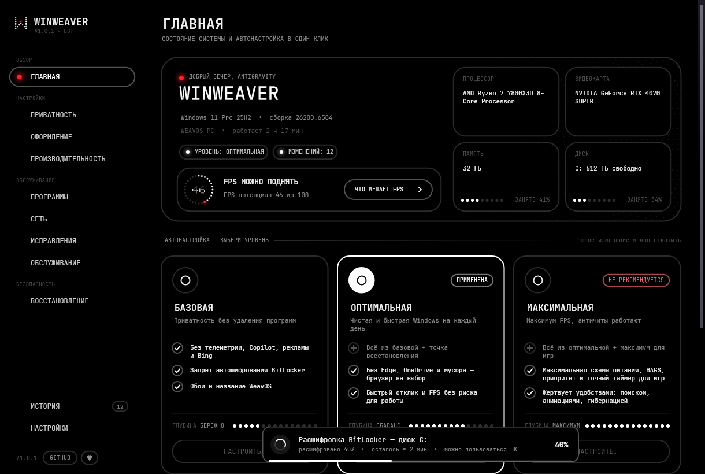

# WinWeaver

Обновление существующего проекта [fel7xxx/WinWeaver](https://github.com/fel7xxx/WinWeaver) с переходом интерфейса на **Avalonia 11.2.3**.
Логика приложения, все страницы, диалоги, анимации и PowerShell-движок перенесены целиком;
отрисовка и окна теперь работают через Avalonia (Skia) вместо GDI+/User32.



## Как устроено

```
WinWeaver/
  App/      — код приложения (MainForm, страницы, карточки, диалоги, движок, Theme, L …)
  Compat/   — слой совместимости WinForms/GDI+ → Avalonia
  Assets/   — шрифты JetBrains Mono (AvaloniaResource)
  Resources/— engine.ps1, картинки, lang.en.tsv, иконка, app.manifest
```

Исходное приложение почти полностью рисует интерфейс само (свои Card, SettingCard, Hero, Sidebar,
TabStrip, переключатели, кнопки…). Чтобы сохранить внешний вид пиксель-в-пиксель и не переписывать
~30 тыс. строк логики, сделан тонкий слой `Compat/`, повторяющий нужную часть API WinForms/GDI+
поверх Avalonia:

| WinForms / GDI+ | Avalonia |
|---|---|
| `Control` | `ControlView : Avalonia.Controls.Control` (раскладка по Bounds, ввод, фокус, z-order) |
| `Form` | `Avalonia.Controls.Window` (рамка, прозрачность, TopMost, модальность через `DispatcherFrame`) |
| `Graphics`, `Pen`, `Brush`, `GraphicsPath`, `Region` | `DrawingContext`, `ImmutablePen`, кисти, `StreamGeometry` |
| `TextRenderer`, `Font` | `TextLayout`, `Typeface` (кэш раскладок) |
| `Bitmap` | `RenderTargetBitmap` / `Bitmap` (с учётом масштаба HiDPI) |
| `TextBox` | настоящий `Avalonia.Controls.TextBox` |
| `ContextMenuStrip` (DarkMenu) | `Avalonia.Controls.ContextMenu` в тёмной теме |
| `Timer`, `BeginInvoke`, `Application.Run` | `DispatcherTimer`, `Dispatcher.UIThread`, `DispatcherFrame` |
| `Clipboard`, `Save/OpenFileDialog`, `Screen`, `Cursor` | `IClipboard`, `StorageProvider`, `Screens`, курсоры Avalonia |

Платформенный код переписан: Win32-окно уведомлений (`UpdateLayeredWindow`) → прозрачное
окно Avalonia; «вуаль» перехода через `PrintWindow` → снимок контрола через `RenderTargetBitmap`;
vsync-поток на `DwmFlush` → таймер кадров диспетчера; `RedrawWindow`, `EM_SETCUEBANNER`,
`SetWindowTheme`, `PrivateFontCollection` и пр. → средства Avalonia. Тёмный заголовок и скругление
окон через DWM на Windows сохранены (используют настоящий HWND окна Avalonia).

## Сборки

### Обновление установленной версии

Распространяется **весь каталог публикации**, не отдельный EXE. Распакуйте архив
в отдельную папку, закройте работающий WinWeaver и запустите новую версию оттуда.
Не удаляйте `%ProgramData%\WinWeaver`: там находятся данные приложения и история отката.
Ключ настроек `HKCU\Software\WinWeaver` сохранён; новые настройки имеют значения по умолчанию.
Обновление файлов пока не транзакционное: перед релизом обязательно проверьте переход
с опубликованной версии в Windows-ВМ со снимком. Номер следующего релиза ещё не назначен.

### Безопасные проверки

```powershell
powershell -NoProfile -File scripts/verify.ps1
```

Проверяются обе сборки, синтаксис PowerShell, откат на заглушках, разбор версий
и копирование зависимостей на временных файлах. Системные твики не применяются.
Ручные сценарии: [чек-лист релиза](docs/RELEASE-CHECKLIST.md).

* **net48** (основная, Windows 10/11) — как и оригинал, хостит Windows PowerShell 5.1 в процессе
  (`PsEngine`, `engine.ps1`), требует права администратора (`app.manifest`).
* **net8.0** — кроссплатформенная сборка для разработки и проверки интерфейса: работает только
  с демо-движком (`FakeEngine`, как ключ `/fake`), ничего в системе не меняет.

```bash
# Windows-версия
dotnet publish WinWeaver/WinWeaver.csproj -f net48 -c Release -r win-x64 --self-contained false -o publish

# Демо-режим (Windows/Linux/macOS)
dotnet run --project WinWeaver/WinWeaver.csproj -f net8.0 -- /fake
```

Нужен .NET SDK 8+. Для net48 на Windows нужен .NET Framework 4.8 (есть в Windows 10/11).
Ключи командной строки и переменные окружения (`/fake`, `WW_FAKE`, `WW_NOANIM`, `WW_SCALE`, `/apply`…)
работают как раньше.

### Скриншоты без дисплея (CI / Linux)

```bash
dotnet run --project WinWeaver/WinWeaver.csproj -f net8.0 -- --shots out
# WW_SHOT_PAGES=home,apps — только указанные страницы
# WW_SHOT_DIALOGS=1      — ещё и диалоги (инфо, подтверждение, автонастройка, приветствие…)
# WW_SHOT_INPUT=1        — проверка кликов/прокрутки
```

Рендер идёт через Avalonia.Headless + Skia (`App/Shots.cs`).

## Ограничения и что проверить

* Порт собран и проверен на Linux (обе сборки компилируются без ошибок; интерфейс net8.0 проверен
  скриншотами всех 12 разделов и 8 диалогов, клики и прокрутка). **На реальной Windows с
  PowerShell-движком запуск не проверялся** — перед релизом прогоните автонастройку и откаты на тестовой машине/ВМ.
* Значки Segoe Fluent Icons берутся из системы — на Windows 11 они есть, на Linux вместо них пусто.
* Сборка — папка с exe и библиотеками Avalonia/Skia (~30 МБ), а не один exe, как раньше.
* Анимации идут от таймера ~60 Гц, а не от DWM vsync.
