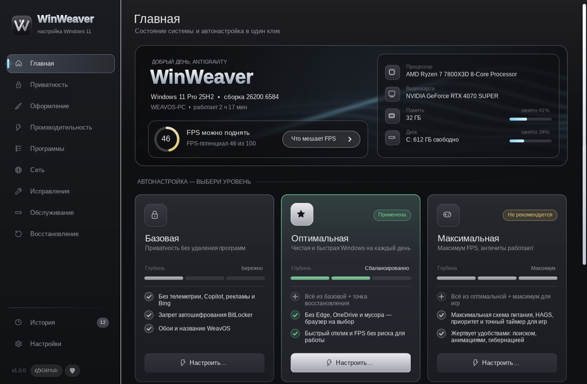
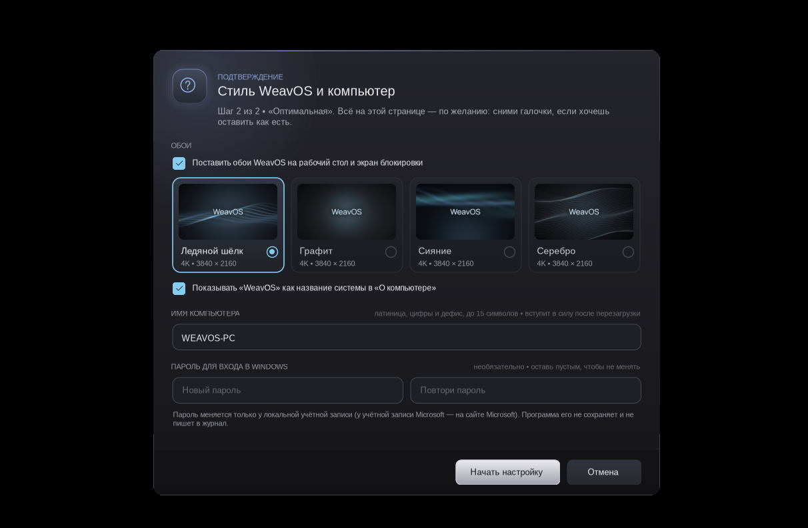
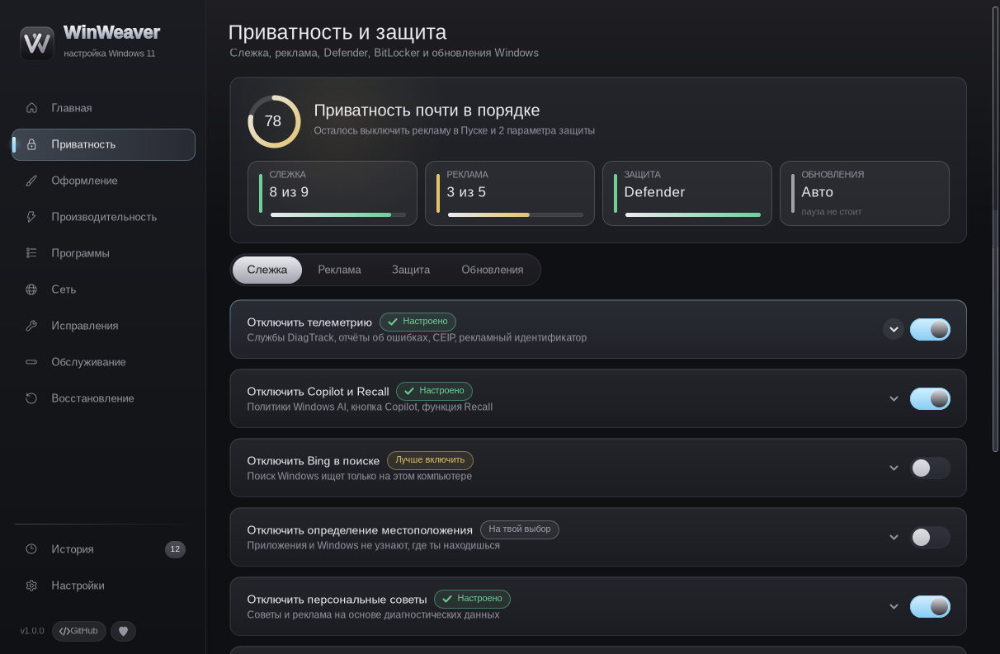
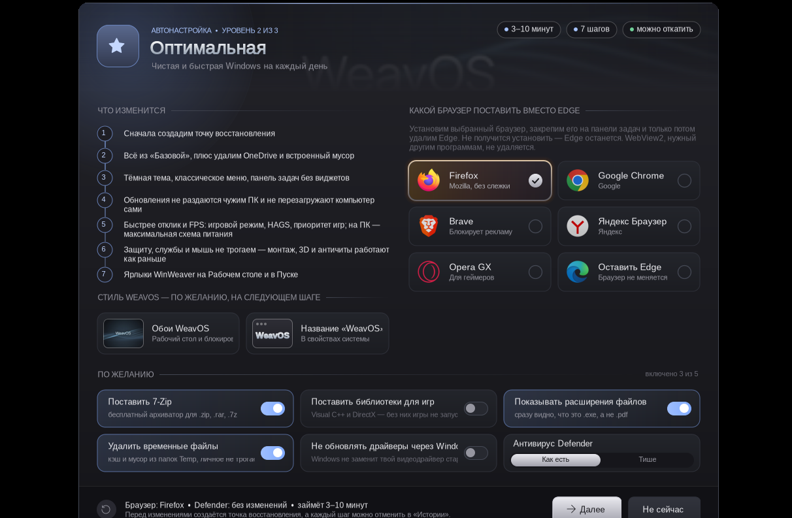
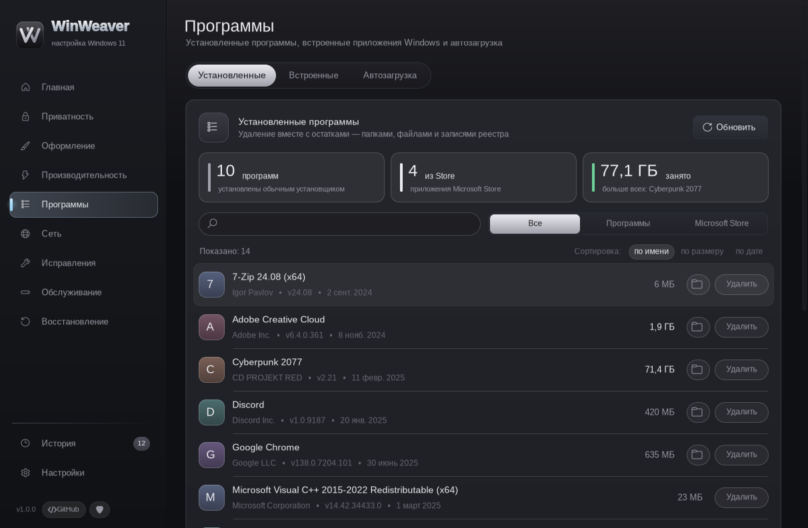
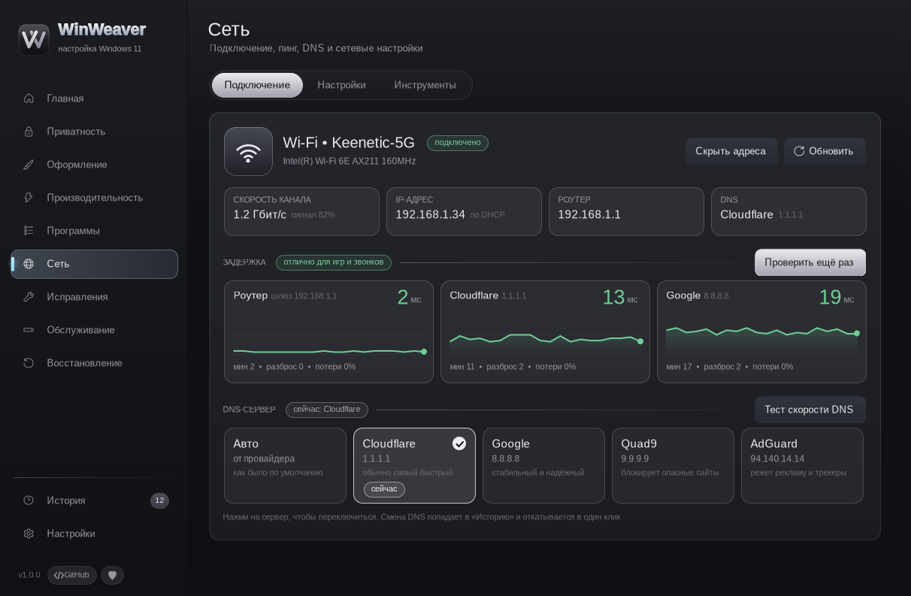
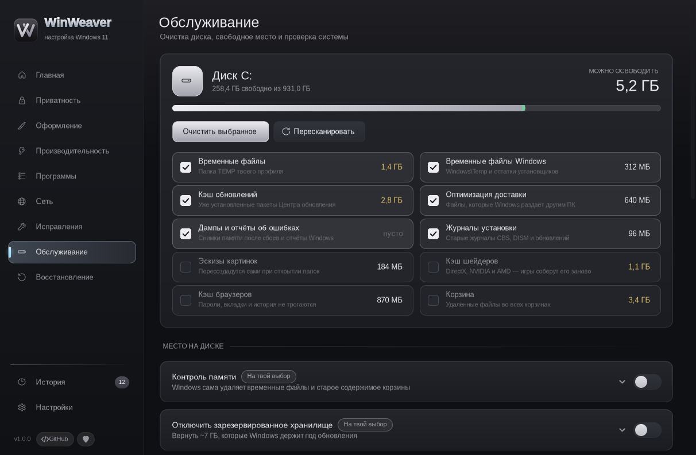
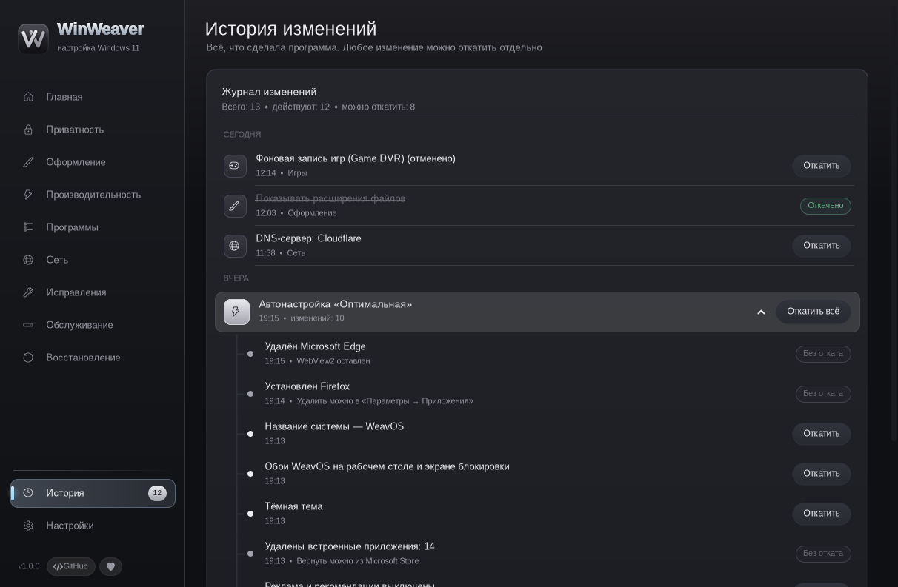

<div align="center">


# WinWeaver

**Настройка Windows 11 в пару кликов — приватность, оформление, скорость и обслуживание.**
Без окон PowerShell и батников. Каждое изменение можно отменить.

[](https://github.com/fel7xxx/WinWeaver/releases/latest)
[](https://github.com/fel7xxx/WinWeaver/actions/workflows/build.yml)
[](LICENSE)

**Русский** · [English](README.en.md)



</div>

## Скачать

1. Открой [последний релиз](https://github.com/fel7xxx/WinWeaver/releases/latest) и скачай **WinWeaver.exe**.
2. Запусти его. Windows спросит права администратора — они нужны, чтобы менять системные настройки.
3. При первом запуске выбери язык и способ запуска: **установить** в Program Files (ярлык в Пуске, удаление через «Установленные приложения») или **запускать без установки**.

> **SmartScreen.** Программа не подписана платным сертификатом, поэтому Windows может показать «Система Windows защитила ваш компьютер». Нажми **Подробнее → Выполнить в любом случае**. Сверить файл можно по SHA-256 из релиза (`WinWeaver.exe.sha256`).

**Требования:** Windows 11 (22H2 – 26H2), права администратора. .NET Framework 4.8 уже есть в Windows 11.

## Что умеет

| | |
|---|---|
| **Автонастройка** | Три уровня — «Базовая», «Оптимальная», «Максимальная». Перед запуском видно каждый шаг, любой можно выключить. Сначала создаётся точка восстановления. |
| **Приватность** | Телеметрия, Copilot и Recall, реклама и рекомендации, Bing в поиске, местоположение, Defender, BitLocker, пауза и режим обновлений Windows. |
| **Оформление** | Тёмная тема, классическое меню, панель задач, Пуск, Проводник. |
| **Производительность** | Схема питания, отклик системы, игровые настройки, HAGS, таймер, приоритеты. |
| **Программы** | Удаление программ вместе с остатками, встроенные приложения Windows, автозагрузка. |
| **Сеть** | Пинг, выбор DNS (в том числе зашифрованного), сетевые настройки и инструменты. |
| **Исправления** | Типичные проблемы Windows решаются одной кнопкой: интернет, Пуск, значки, звук, принтер, Центр обновления… |
| **Обслуживание** | Очистка диска, «Контроль памяти», проверка системных файлов. |
| **Восстановление** | Точки восстановления: создание, откат, удаление старых. |
| **История** | Всё, что сделала программа. Любое изменение отменяется отдельно или группой. |

### Стиль WeavOS — по желанию
На втором шаге автонастройки можно поставить обои **WeavOS** (4 варианта в 4K), показать «WeavOS» как название системы в «О компьютере», задать имя компьютера и пароль входа. Любой пункт можно пропустить.



### Безопасность прежде всего
- **Экспертный режим.** Настройки, которые ослабляют защиту или могут сломать программы (полное отключение Defender, VBS/HVCI, защита от Spectre, «Не спрашивать» в UAC, отключение служб, расшифровка BitLocker), скрыты, пока ты сам не включишь режим в «Настройках».
- **Edge** удаляется только после установки выбранного браузера и только официальным деинсталлятором; WebView2, нужный другим программам, остаётся.
- **«Что вернула Windows».** Крупные обновления иногда включают настройки обратно — программа это заметит и предложит применить их снова.
- Скачанные установщики проверяются по цифровой подписи или по SHA-256. Подробнее — в [SECURITY.md](SECURITY.md).

### Ещё
- **Профили:** экспорт и импорт настроек в `.json`, чтобы перенести их на другой ПК.
- **Новые версии:** раз в день программа может проверить GitHub и сообщить о релизе. Сама ничего не скачивает.
- **Языки:** русский и английский (по умолчанию — как в Windows). Можно добавить свой перевод — см. [CONTRIBUTING.md](CONTRIBUTING.md).
- **Полное удаление:** «Настройки → Удалить WinWeaver» — по желанию сначала откатить все изменения.

## Скриншоты

| | |
|---|---|
|  |  |
|  |  |
|  |  |

## Командная строка

```
WinWeaver.exe /apply <light|optimal|gamer> [/browser <keep|firefox|chrome|brave|yandex|operagx>]
              [/opts "7zip,vc,ext,temp,drv"] [/wallpaper 1-4] [/nowall] [/noname]
              [/defender <asis|quiet>] [/restart]
WinWeaver.exe /uninstall [/quiet] [/undo]
WinWeaver.exe /version
WinWeaver.exe /help
```
`light` — «Базовая», `optimal` — «Оптимальная», `gamer` — «Максимальная». Всё записывается в «Историю», журнал — `C:\ProgramData\WinWeaver\tweaker.log`.

## Частые вопросы

**Можно ли всё вернуть?** Да. Каждое изменение — в «Истории», кнопка «Откатить». Перед автонастройкой создаётся точка восстановления.

**Антивирус ругается.** Программы, которые меняют системные настройки, иногда ошибочно помечаются. Исходный код открыт, exe собирается на GitHub Actions прямо из этого репозитория — сверь SHA-256.

**Нашёл ошибку.** «Настройки → Сообщить об ошибке» — откроется форма на GitHub, версия и журнал подставятся сами. Вопросы — в [Обсуждениях](https://github.com/fel7xxx/WinWeaver/discussions).

## Поддержать проект

WinWeaver бесплатный и останется таким. Если программа помогла — можно оставить чаевые:

- **Boosty:** https://boosty.to/fel7xxx/donate
- **TON:** `UQB_35tg7SFtMrJVeU5W6MoB2shypmmpBcJUJKG5WfvCuOMc`
- **Bitcoin (BTC):** `bc1qpn0wasg3mkgdhepkpy5qjg9rmw793f85jq8f5m`

Ещё очень помогают ⭐ на GitHub и сообщения об ошибках.

## Сборка из исходников

```
cd app
dotnet build -c Release -o out
```
Нужен .NET SDK 8. Подробности, устройство проекта и правила — в [CONTRIBUTING.md](CONTRIBUTING.md). Демо без изменений в системе: `WinWeaver.exe /fake`.

## Лицензия

© 2026 fel7xxx. Код распространяется по лицензии [GNU GPL v3.0](LICENSE).
Названия **WinWeaver** и **WeavOS**, логотип и обои — см. [TRADEMARKS.md](TRADEMARKS.md): форки нужно переименовать и указать «Основано на WinWeaver от fel7xxx».

Программа меняет системные настройки Windows. Она распространяется «как есть», без гарантий — пользуйся точками восстановления и «Историей».
